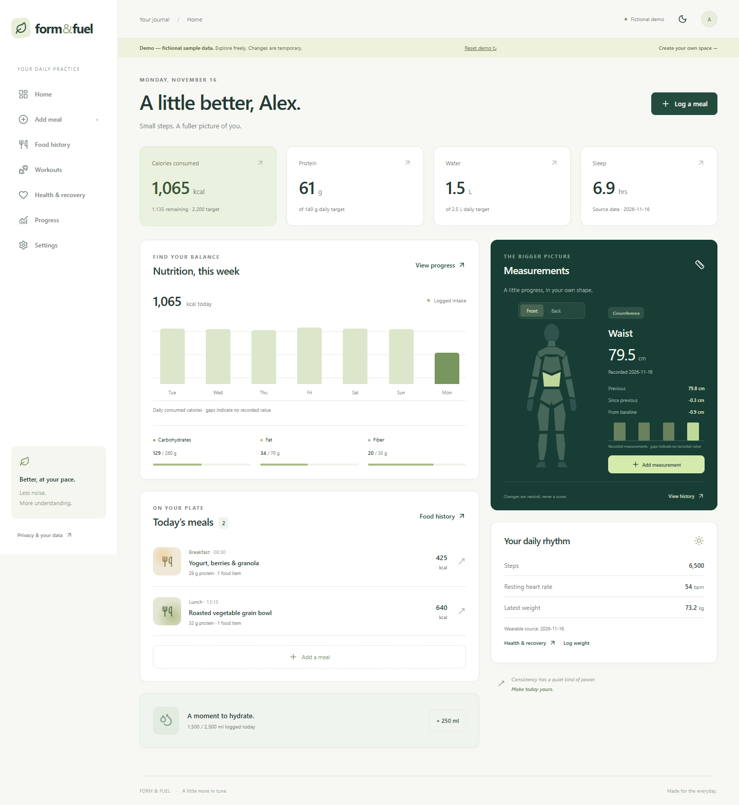
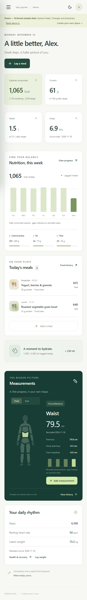
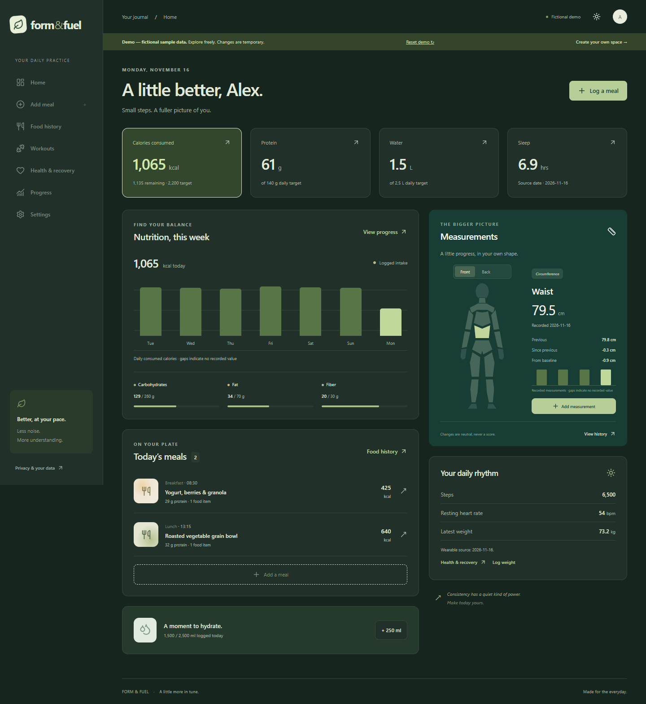
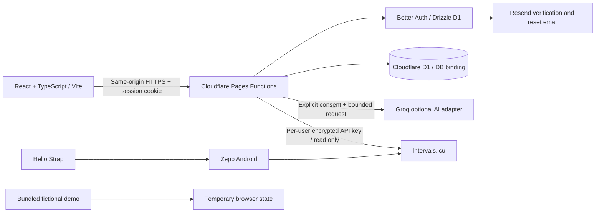

# Form & Fuel

A private home for meals, movement, and everyday health records. Built with React, TypeScript, Cloudflare **Pages + Pages Functions**, D1, Better Auth, optional Groq estimates, and per-user Intervals.icu imports.

**Status:** deployed on Pages with verified D1 health. Types, lint, 20 unit/integration tests, 4 browser workflows and an observed GitHub Actions run passed. **Private accounts remain blocked by missing production secrets.** Real email, Groq and wearable checks remain unverified. See [verification](docs/verification.md).

Intended application: https://form-and-fuel-shyam.pages.dev · Isolated recruiter demo: https://form-and-fuel-shyam.pages.dev/demo

## What it does

- Verified email/password accounts, single-use email codes, password reset, expiring sessions, account settings, export, and deletion.
- Manual meals and editable AI previews, explicit saving, idempotent creates, recipes with serving scaling, history and date filters.
- Dated weight, water, and circumference records with metric/imperial conversion. An interactive front/back SVG body map provides keyboard access and a table alternative. It is a measurement map, not a muscle-activation heatmap.
- Workout plans with textual rep/load expressions, day copying, exercise ordering, notes, and reviewed XLSX/CSV import. Completed sessions preserve a planned snapshot and separately record actual sets. Wearable activities can link to sessions.
- Sleep, steps, resting heart rate, rMSSD and SDNN, available activity fields, and clearly separated workout calories. Missing values remain unknown.
- Per-user encrypted Intervals credentials, read-only API access, resumable 30-day history batches, source dates versus fetch timestamps, overlap refresh, concurrency leases, and retry backoff.
- Optional user-triggered Groq text/vision estimates and weekly reviews. AI is disabled by default. Photo upload has preview, replacement/removal and client resizing; live analysis additionally requires verified model availability and `AI_VISION_ENABLED=true`.
- Light/dark responsive UI, accessible navigation and charts, PWA manifest/icons, public-static-only service worker, and honest offline status.

## The demo

`/demo` uses bundled synthetic fixtures and memory-only edits. It never requests `/api`, reads real accounts, uses integration credentials, or calls Groq. AI responses are explicitly simulated. Reset or refresh restores fixtures. [Sample XLSX](public/samples/strength-plan.xlsx) and [CSV](public/samples/strength-plan.csv) contain fictional exercises and notes for import review.

Screenshots below are captured from the implemented demo by browser tests, not design mockups:





## Architecture



`functions/api/[[path]].ts` is a Pages Function, **not** a standalone Worker deployment. No cron infrastructure is provisioned. Scheduled upstream imports are not claimed.

### Main paths

- `src/pages/`: application screens; `src/components/`: shared UI and SVG map.
- `src/lib/domain.ts`: validation, unit conversions, nutrition totals and training-volume rules.
- `src/lib/importer.ts`: deterministic multi-sheet importer; formulas become inert text; original notes remain reviewable.
- `src/lib/store.tsx`: private API client versus isolated demo state.
- `server/app.ts`: authenticated routes and ownership boundaries.
- `server/auth.ts`, `auth-schema.ts`: maintained password hashing, OTP and session handling.
- `server/intervals.ts`, `crypto.ts`: normalization, authenticated encryption and bounded imports.
- `server/ai.ts`: replaceable provider interface, runtime validation and shared quotas.
- `server/export.ts`: bounded streaming export without credentials.
- `migrations/`: append-only schema migrations. `scripts/`: repeatable setup, deployment and verification.

## Local setup

Use a supported Node LTS, currently Node 24+ for this lockfile. The implementation machine verified Node `24.22.1`, npm `11.21.2`, Git `2.42.0.windows.2`. npm was initially missing and installed locally; no administrator installation was required.

```sh
npm ci
npm run setup:local
npm run db:local
npm run build
npm run dev:api
# Open http://localhost:8788/demo
```

`setup:local` generates ignored local-only authentication/encryption secrets without printing them and preserves an existing `.dev.vars`. Enter email/Groq credentials directly in that file when needed. `.dev.vars.example` contains placeholders only. For UI iteration, `npm run dev` proxies `/api` to port 8788, but authenticated testing should use the configured same-origin Pages address; add an explicitly trusted development origin only if needed.

On the original Windows machine npm can also be run with:

```powershell
$env:PATH = 'C:\projects\.tooling\node_modules\npm\bin;' + $env:PATH
npm --version
```

## Production configuration

Run `npx wrangler login`, complete authorization yourself, then `npx wrangler whoami`. Use the intended account; no account IDs or credentials should be guessed. The setup script reuses an exactly named database and Pages project without resetting data:

```sh
npm run setup:cloudflare
npm run db:remote
```

Set production **secrets** directly in Cloudflare Pages settings or through Wrangler’s interactive secret prompt. Never paste values into chat or commit them:

```sh
npx wrangler pages secret put BETTER_AUTH_SECRET --project-name form-and-fuel-shyam
npx wrangler pages secret put INTEGRATION_ENCRYPTION_KEY --project-name form-and-fuel-shyam
npx wrangler pages secret put RESEND_API_KEY --project-name form-and-fuel-shyam
# Optional, only after reviewing terms and free-tier limits:
npx wrangler pages secret put GROQ_API_KEY --project-name form-and-fuel-shyam
npx wrangler pages secret list --project-name form-and-fuel-shyam
```

`BETTER_AUTH_SECRET` needs at least 32 random characters. `INTEGRATION_ENCRYPTION_KEY` must be base64 of 32 random bytes. Keep recoverable secrets in your own password manager; losing the encryption key makes stored integration credentials unreadable. Do not rotate it without a migration strategy or requiring reconnection.

Non-secrets in `wrangler.json`: `APP_URL`, `EMAIL_FROM`, `GROQ_MODEL`, `AI_ENABLED`, optional `AI_VISION_ENABLED`, and the `DB` binding. Wrangler configuration is the source of truth for these values; update it and redeploy. The Pages preview hostname is not automatically trusted for production auth; use the configured production origin.

### Authentication and email

Better Auth is self-hosted; there is no separate paid authentication service. Its secure hashing implementation handles passwords. Email OTP codes expire in 10 minutes, are hashed at rest, allow five attempts and are consumed on successful verification/reset. Sessions last seven days; reset revokes existing sessions. Auth rate limits persist in D1, and mutations require the configured origin.

Resend needs a valid API key and verified sending domain for public registration. `Form & Fuel <onboarding@resend.dev>` is configured for **development testing only**, with delivery restricted to the Resend account owner. It is not a public multi-user production email solution. Replace `EMAIL_FROM` with a sender on your own verified domain and redeploy before inviting other users. Cloudflare’s `noreply@notify.cloudflare.com` cannot be used as your application sender.

Registration remains blocked when email credentials are unavailable; verification is never silently bypassed. Mocked email tests do not prove real delivery. See `docs/setup-secrets.md` for the user-driven live flow.

### Groq

Only Groq is implemented; there is no OpenAI default or paid fallback. Default model `qwen/qwen3.8-27b` was selected from current official documentation; confirm availability in your own account before enabling it. `AI_ENABLED=false` is the safe initial configuration. Review the account’s free limits and [data handling](https://console.groq.com/docs/your-data). Data is sent only after the user requests processing and consents. Abuse-handling exceptions mean this is not a blanket zero-retention guarantee.

Admission limits: 10 requests per user/day, 20 app-wide/day, 1 app-wide/minute; 1,800 output tokens; bounded text context and 512-pixel images. Limits are deliberately conservative, shared with all users and measured in UTC windows. Requests do not retry automatically. Provider 429s return a clear error and manual features remain available. No billing is enabled. Production text and vision behavior remains unverified until configured and live-tested.

### Intervals.icu / Zepp

Sync your strap to Zepp, authorize the official Amazfit/Zepp connection in Intervals.icu settings, and enable relevant activity and wellness imports. No Zepp Developer Mode, password scraping, or direct Bluetooth access is used.

Each verified user enters their own API key and athlete ID through Settings. Basic auth uses username `API_KEY`; the server verifies the intended athlete before saving an AES-GCM encrypted credential. Intervals.icu recommends OAuth for apps intended for multiple users; this initial personal-key implementation follows the requested scope and requires reconsideration before broader distribution.

Choose an earliest date rather than searching backwards forever. A request imports one 30-day batch; the UI runs up to four requests per click, then pauses for explicit continuation. No 90-day cap is imposed. After backfill, a recent 14-day overlap is re-fetched. Dashboard access requests a throttled refresh, not live streaming. Sync does not trigger Zepp’s upstream upload. Provider history restrictions still apply. Cached records remain after failures, and disconnection lets users retain or delete imported records. Reconnecting a different athlete is blocked until old imported history is removed.

## Tests and CI

```sh
npm run typecheck
npm run lint
npm test
npm run build
npm run test:browser
```

Integration tests use Miniflare’s isolated D1 runtime and mocked external providers. They require loopback networking but no production credentials or health data. Browser tests use installed Chrome locally and Playwright Chromium in CI. CI installs the lockfile and runs types, lint, tests, build and browser checks on main pushes and pull requests. Deployment secrets are not available to these jobs. **A workflow file is not evidence of a passing CI run**; observed status is recorded in verification notes.

## Deploy and update

### Google sign-in

Create a Google OAuth **Web application** client for the production site. Use JavaScript origin `https://form-and-fuel-shyam.pages.dev` and redirect URI `https://form-and-fuel-shyam.pages.dev/api/auth/callback/google`. Save `GOOGLE_CLIENT_ID` and `GOOGLE_CLIENT_SECRET` in Cloudflare Pages **Production secrets**, then redeploy. Only `openid`, `email` and `profile` are requested. Google sign-in remains hidden until both settings exist. `/api/auth-options` reports configuration booleans without revealing credentials.

Google Auth Platform's Testing audience admits only configured test users. Test the owner account first, then configure the production audience for the intended users before sharing. Google may require additional branding/domain verification for published branding; follow the requirements shown in the console. Never add Gmail or Drive permissions for basic sign-in.

Google-verified accounts do not need Resend signup OTPs. Existing verified accounts can use the same email with Google while keeping their user ID and records. Unverified local accounts are not implicitly linked. OAuth uses state, PKCE, restricted callback routes and encrypted stored tokens. Google-only account deletion requires a sign-in within five minutes; password accounts still require password confirmation. Resend's `resend.dev` sender remains owner-only for email/password registration and password-reset delivery.

### Android APK

`android/` is the Bubblewrap-generated Android Trusted Web Activity project for the existing Pages site. It uses a supported Android browser, not an embedded login WebView. The app contains no Cloudflare, Resend, Groq or Google client secrets. Website updates are served from the same backend; an internet connection is required for private records and AI.

Use Java 17 and Android SDK platform/build tools 36. `android/local.properties` points to the local SDK and is ignored. With `JAVA_HOME`, `ANDROID_SDK_ROOT` and a private signing configuration available, run `node scripts/build-android.mjs`. It builds, aligns, signs and verifies `artifacts/releases/Form-and-Fuel-1.0.0.apk`. The `public/.well-known/assetlinks.json` certificate fingerprint must match that APK's signing certificate and be deployed for full-screen website verification.

Back up `artifacts/private/android/` privately: it holds the release keystore and signing configuration. Never upload that folder to source control or distribute it with the APK. Future APK updates must retain the same package ID/signing key and increment the version code. Building and signature verification do not replace a physical-phone installation and login test.

```sh
npm run check
npm run deploy
npm run verify:live
```

`deploy` checks types, builds, applies versioned remote migrations, deploys through `wrangler pages deploy`, and verifies the live shell, direct routes and `/api/health`. A successful health check queries the database and verifies schema availability. It does not prove email, AI or wearable integrations work.

For changes, create a branch, review diffs, test and add migrations. Never reset production data to apply a feature. Reverting a Pages deployment only reverts code; it does not reverse a D1 migration. Prefer additive schema changes, validate existing rows, and plan database recovery separately using actual Cloudflare retention options.

## Privacy, security and limitations

See [SECURITY.md](SECURITY.md), the in-app `/privacy` notice, and [engineering decisions](docs/engineering-decisions.md). Do not publish user exports, databases, local secrets, private screenshots, or logs. Backups may retain deleted rows for the provider’s retention window; no unsupported compliance or instant-backup-erasure claim is made.

Current limits: personal-key integration instead of OAuth; request-driven sync; no automatic scheduling; no provider-photo/model live verification yet; no offline write queue; conservative shared AI quotas; workbook interpretation requires review; diary screens load 200 records per page; long-range progress aggregates query the whole requested range. The importer chunk is lazy-loaded and roughly 929 kB minified, a known bundle-size warning. Exports stream pages and should be taken without concurrent edits for a consistent snapshot. Body-map baseline means earliest loaded measurement until all earlier pages are loaded. Training loads retain explicit kg/metres/seconds labels in the workout editor.

Future work, not claimed as delivered: provider OAuth registration, distributed job scheduling, richer source sleep stages where exported, verified transactional sending domain, stronger integration test coverage for provider edge cases, and measured production performance.

## License and contribution

MIT permits portfolio review, learning, reuse and modification while retaining attribution. It covers this project’s source, not third-party services or dependencies. See [CONTRIBUTING.md](CONTRIBUTING.md) and [portfolio notes](docs/portfolio-notes.md). Development used AI assistance; all claims are based on delivered code and observed verification, not invented user or business outcomes.
